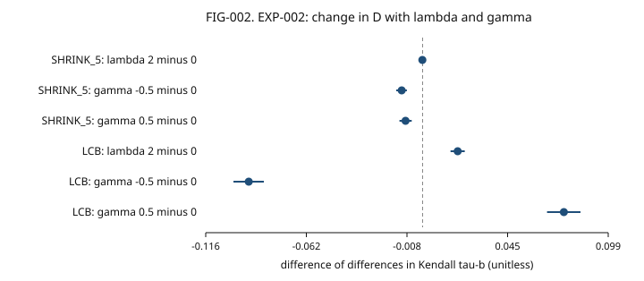

<!-- SPDX-License-Identifier: LicenseRef-TRUST-NC-Research-1.0 -->
# When does shrinkage beat the average star rating? A preregistered simulation of rank recovery under noise, sparsity and misspecification

**Author:** Mohamed Bechir Kefi (no affiliation).

**Status:** independent research manuscript / preprint draft, not peer-reviewed. Version M4, 2026-11-25. Protocol v1.0 frozen by the owner on 2026-11-24 before any confirmatory run.

**Data:** all results are simulated. Two simulation parameters are calibrated on MovieLens 1M [@harper2015], which is not redistributed. Real product quality is unobserved, and nothing here describes any commercial platform or labels any review.

## Abstract

Sorting products by their average star rating favours items with few reviews; Bayesian averages and lower credible bounds are common remedies. How much they change the recovered order, and when, is less clear. In a preregistered simulation where the true quality of 200 products is known by construction, we compared the arithmetic mean (MEAN) with a Bayesian average of five pseudo-reviews at the catalogue mean (SHRINK_5, primary arm), variants with one and twenty pseudo-reviews, and a Dirichlet lower credible bound (LCB). The design crossed review count, rating noise, reporting selection and quality-dependent exposure, with 20 seeds per cell and four prespecified sensitivity analyses (1,560 runs, none failed). The primary estimand, the grid-average difference in Kendall tau-b between SHRINK_5 and MEAN, was 0.0046 (95% interval 0.0030 to 0.0061), so the frozen rule declares the primary hypothesis supported. Its sign depends on rating noise: -0.0198 (-0.0225 to -0.0172) at 0.5 stars, 0.0085 (0.0056 to 0.0113) at 1.0 and 0.0250 (0.0224 to 0.0277) at 1.5. The advantage survives removing unreviewed products but reverses when the shrinkage centre is off by half a star or the quality distribution changes shape. The predicted decline with review count was contradicted, and the LCB ranked whole lists worse than MEAN. In the conditions tested, shrinkage helped ranking when ratings were noisy and the prior matched the population, and hurt it otherwise.

**Keywords:** rating aggregation; empirical Bayes shrinkage; ranking under uncertainty; Kendall tau; simulation study; preregistration.

## 1. Introduction

Online catalogues commonly summarise each product by the arithmetic mean of its star ratings and sort by that number. A product with one five-star review then outranks a product with hundreds of reviews averaging 4.8. Practitioner guidance has long pointed this out and proposes two remedies: a Bayesian average, which adds pseudo-reviews at a global mean [@miller2012; @algolia], and a lower bound on a posterior or confidence interval [@miller2009; @miller2014]. The statistical idea behind the first remedy, shrinking separate estimates towards a common value, goes back at least to the empirical Bayes work of Efron and Morris [@efron1975].

These remedies are standard; this paper does not propose a new estimator. The gap it addresses is narrower: whether, and under which conditions, accounting for sample size improves the recovered **order** of products, measured against a known truth, and how sensitive that improvement is to the assumptions it rests on. Better squared-error estimates do not automatically give a better ranking, and a remedy that helps in one regime can hurt in another.

**Research question.** When do average ratings misrank products compared with uncertainty-aware estimators?

**Hypotheses (frozen before data).** H1: the grid-average rank-recovery advantage of SHRINK_5 over MEAN is positive. H1b: the advantage decreases as the mean review count grows, at every noise level. H1c: the LCB also beats MEAN. H2 (nondirectional, exploratory in intent): the advantage changes with reporting selection and with quality-dependent exposure. Four sensitivity analyses could invalidate the main interpretation.

**Contributions.**

1. A preregistered simulation design, frozen by the owner with file hashes before any confirmatory output, with prespecified decision rules and invalidation criteria (section 4).
2. A complete set of confirmatory results, including the contradicted and unsupported hypotheses and two triggered invalidation criteria (section 5).
3. Evidence that, under this model, the sign of the shrinkage advantage is set by rating noise and that the advantage is fragile to a misspecified shrinkage target or population shape (sections 5 and 6).
4. An open evidence chain: per-run provenance, checksums, a generator for every table and figure, and an audit that recomputes the frozen analysis from the raw results (section 10).

## 2. Related work

This is a scoping review, not a systematic one; the access status of each source is listed in the references and in `research/literature_review.md`.

**Ranking by average rating.** Miller argues that sorting by a raw average or by the difference of positive and negative votes misorders items with few ratings, and proposes the lower bound of the Wilson score interval for binary ratings [@miller2009]. For star ratings he proposes a Dirichlet posterior over the five star levels and sorting by the posterior mean minus a multiple of its standard deviation [@miller2014]; our LCB arm follows that formula, with the prior recentred as described in section 3. A related note frames the ranking criterion as the result of an asymmetric loss chosen by the designer [@miller2012]. A practitioner guide documents the Bayesian average $(n\bar{x} + C m)/(n + C)$ as a common way to rank by rating [@algolia]; it shows that SHRINK is current practice rather than a contribution.

**Shrinkage.** Efron and Morris study Stein-type estimators that shrink separate means towards a common value [@efron1975]. Only the first page of that article was read for this project, so it is cited for the general idea and not for any specific result. Whether shrinkage improves the ordering of items, as opposed to their estimates, is the question tested here.

**Selection in online ratings.** Hu, Pavlou and Zhang describe purchasing and under-reporting biases that produce J-shaped rating distributions and make the mean a biased estimator of quality [@hu2007wp]; only the title page and abstract were read. Li and Hitt describe self-selection of early reviewers [@li2008]; only the abstract was read. These works motivate the selection and exposure factors of EXP-002. They do not validate the functional forms or parameter values used here.

**Relation to this study.** The study replicates no prior experiment. It extends the practitioner argument by measuring, against a known truth, the size and sign of the rank-recovery change and its dependence on noise, sparsity, selection and prior misspecification. Statistical work on ranking under uncertainty (for example posterior expected ranks) was not searched, so we claim no novelty relative to it.

## 3. Formal model

All quantities are synthetic; protocol `research/protocol.md` sections 2 to 5 gives the full definitions.

**Products and quality.** A catalogue has $N = 200$ products. Latent quality is $\mu_i = 1 + 4B_i$ stars, $B_i \sim \mathrm{Beta}(a, b)$, with $(a, b) = (4.2726, 3.1944)$ from the MovieLens fit (section 4.2).

**Ratings.** A potential rating is $r_{ij} = \mathrm{clip}(\lfloor \mu_i + \sigma \varepsilon_{ij} + 0.5 \rfloor, 1, 5)$ with $\varepsilon_{ij} \sim N(0, 1)$, so $\sigma$ is rating noise in stars.

**Truth.** The ranking target is the expected rating $\theta_i = E[r_{ij} \mid \mu_i, \sigma] = \sum_{k=1}^{5} k \, P(r = k \mid \mu_i, \sigma)$, computed exactly. For fixed $\sigma$ it is strictly increasing in $\mu_i$.

**Review counts and exposure.** Potential raters follow $n^*_i \sim \mathrm{NegBin}(\text{mean } \nu w_i, \text{shape } r)$ with $r = 0.4909$ from the MovieLens fit, so zero reviews occur. The exposure weight $w_i = \exp(\gamma z_i) / \overline{\exp(\gamma z)}$, with $z_i$ the standardised $\mu_i$, couples exposure to quality when $\gamma \neq 0$.

**Reporting selection.** A potential rating $r$ is reported with probability $\pi(r) = (1 + \lambda |r - 3| / 2) / (1 + \lambda)$; $\lambda > 0$ under-reports moderate ratings.

**Estimators.** With $n_i$ reported ratings of mean $\bar{x}_i$ and catalogue mean $m$ of all reported ratings:

- MEAN: $s_i = \bar{x}_i$, or $m$ if $n_i = 0$ (baseline).
- SHRINK($\kappa$): $s_i = (n_i \bar{x}_i + \kappa m) / (n_i + \kappa)$, $\kappa \in \{1, 5, 20\}$; $\kappa = 5$ is the prespecified primary arm.
- LCB: posterior mean minus $1.645$ posterior standard deviations under a Dirichlet prior $\alpha_k = 5 p_k$, where $p_k$ is the catalogue share of star level $k$ (amendment A-1: the prior has Miller's total strength of five pseudo-ratings but is centred on $m$).
- ORACLE: $s_i = \theta_i$ (implementation check only; must give tau-b = 1).

Ties in score are broken by product id; rank metrics use tau-b, which treats ties explicitly.

**Primary metric and estimand.** Kendall tau-b between scores and $\theta$ over all 200 products. For one catalogue, $D = \tau_b(\text{SHRINK}_5) - \tau_b(\text{MEAN})$. The primary estimand $\bar{D}$ is the equal-weight mean over the nine EXP-001 cells of the per-cell expected $D$. Amendment A-2 adds $D_\sigma$, the equal-weight mean of the three cells at each noise level. Secondary metrics are Spearman's rho, precision at 10, regret at 10 (mean $\theta$ of the true top 10 minus that of the arm's top 10, in stars), interval coverage and RMSE.

**Complexity.** Each estimator is linear in the number of ratings; tau-b is computed in $O(N \log N)$ and validated against an $O(N^2)$ reference. A full experiment runs in seconds on a laptop (section 4.5).

## 4. Methods

### 4.1 Design and registration

Three experiments were registered (`research/experiment_registry.csv`) and frozen by the owner on 2026-11-24 with SHA-256 hashes of the study protocol, the three experiment protocols, seven configs and the data manifest (`research/freeze.json`; decision D-010). A run guard refuses any config whose hash differs from the freeze record.

- **EXP-001 (primary).** Mean review count $\nu \in \{3, 10, 30\}$ by noise $\sigma \in \{0.5, 1.0, 1.5\}$; $\lambda = 0$, $\gamma = 0$; 9 cells, 20 seeds, 180 catalogues.
- **EXP-002.** $\lambda \in \{0, 2\}$ by $\gamma \in \{-0.5, 0, 0.5\}$ by $\nu \in \{3, 10\}$; $\sigma = 1.0$; 12 cells, 240 catalogues.
- **EXP-003 (sensitivity).** S1: metrics restricted to products with $n_i \ge 1$ and, separately, $n_i \ge 5$. S2: SHRINK_5 centred at $m + 0.5$ and $m - 0.5$. S3: truth $\theta$ versus the expected reported rating $\theta^{rep}$ on EXP-002 catalogues. S4: quality $\mathrm{Beta}(1, 1)$ and an equal mixture of $\mathrm{Beta}(2, 6)$ and $\mathrm{Beta}(6, 2)$. 1,140 catalogues.

All arms score the same catalogue (paired design). Seeds derive from `SeedSequence([20261124, exp_number, seed_index])` with separate streams for quality, counts, ratings and reporting, so a seed shares its latent qualities across cells.

### 4.2 Calibration on MovieLens 1M

MovieLens 1M (1,000,209 ratings of 3,883 listed movies) was used for calibration only [@harper2015]; the data are fetched by script and never committed. Movies were split once into a fit half (1,941 movies) and a check half (1,942). On the fit half, a negative binomial fitted by maximum likelihood gave the shape $r = 0.49090$, and a marginal maximum-likelihood fit of the model of section 3 gave $\mathrm{Beta}(4.27261, 3.19443)$ and a reference noise $\sigma = 1.05215$, which is not used (the noise grid is a design factor). The fit computed no estimator, catalogue or contrast. On the check half the model misfits the star shares: 1-star and 4-star shares are under-predicted (0.078 and 0.268 predicted against 0.110 and 0.303 observed) and 2-star and 5-star shares over-predicted. The fitted values entered the configs rounded to four decimals.

### 4.3 Statistical analysis

Per cell, the mean paired difference has a 95% percentile bootstrap interval over seeds (10,000 resamples, fixed seed) with a t interval as cross-check. Pooled quantities use a stratified bootstrap that resamples seeds within cells. **H1** is supported if the one-sided 95% lower bound of $\bar{D}$ is above 0. If the $D_\sigma$ intervals exclude 0 with opposite signs, A-2 requires the result to be stated as "the direction depends on the noise level". **H1b** is contradicted if the order $\nu = 3 > 10 > 30$ fails in a majority of noise levels or the $\nu = 3$ and $\nu = 30$ intervals overlap at every level. The secondary family (H1b contrast, H1c, SHRINK_1 and SHRINK_20 against MEAN) uses Holm at $\alpha = 0.05$. EXP-002 uses same-seed paired differences of $D$ between factor levels within strata, averaged with equal weight, with Holm across the lambda and two gamma contrasts. EXP-003 invalidation criteria are sign reversals (S2, S4), an interval reaching 0 (S1) and sign differences in a majority of cells (S3).

The frozen text named Holm but no p-value; the analysis layer, committed before any confirmatory catalogue existed, uses bootstrap p-values from the same resamples (decision D-011, accepted by the owner with disclosure, D-013).

### 4.4 Confirmatory versus exploratory work

Every result in section 5.1 to 5.3 is confirmatory. Before the freeze, exploratory pilots under the planning generator were run; the freeze record (`research/freeze.json`, item C4) lists the contrast values seen. They showed the same sign change by noise and motivated amendment A-2. The noise dependence reported below is therefore a confirmatory replication of a pattern seen in pilots, not a prediction made blind to it. Section 5.4 reports three post-hoc exploratory checks made at M4 (journal JRN-0010); they never change a frozen verdict.

### 4.5 Implementation, compute and reproducibility

Python 3.12.1 with numpy 2.3.4 and scipy 1.16.2, locked by `uv.lock`; Apple M1 Pro, 16 GiB, macOS 15.3.1. All 1,560 confirmatory runs executed at revision `bd9e146` (clean tree) on 2026-11-24 between 23:35:19 and 23:35:48 UTC; EXP-001 took 2.22 s of wall time. No run failed or was retried. Before the runs, the test suite passed (165 tests), 26 of 26 metric-validation checks passed, and the ORACLE arm gave tau-b = 1 in every confirmatory run.

## 5. Results

All values are simulated and unitless (tau-b differences) unless stated. Intervals are two-sided 95% stratified bootstrap intervals.

### 5.1 EXP-001: shrinkage versus the mean (primary)

**H1.** $\bar{D} = 0.0046$ (0.0030 to 0.0061), one-sided 95% lower bound 0.0032, nine cells: **supported** under the frozen rule.

**Per noise level (A-2).** The three intervals exclude 0 with opposite signs, so the frozen wording applies: **the direction depends on the noise level** (Table 1, Figure 1).

Table 1. EXP-001, $D$ = tau-b(SHRINK_5) minus tau-b(MEAN), by noise level and review count (20 seeds per cell). Source: `research/experiments/EXP-001/results_tables.md`.

| sigma (stars) | $D_\sigma$ (95%) | $\nu = 3$ | $\nu = 10$ | $\nu = 30$ |
|---|---|---|---|---|
| 0.5 | -0.0198 (-0.0225 to -0.0172) | -0.0109 | -0.0234 | -0.0253 |
| 1.0 | 0.0085 (0.0056 to 0.0113) | 0.0078 | 0.0069 | 0.0107 |
| 1.5 | 0.0250 (0.0224 to 0.0277) | 0.0183 | 0.0260 | 0.0309 |

Every per-cell interval excludes 0 (supplementary Table S2). Shrinkage ranks worse than the mean in all three low-noise cells and better in all six others.

{fig-alt="Dot-and-interval chart. The three sigma 0.5 cells and their mean lie left of zero, between about -0.011 and -0.025. The sigma 1.0 and 1.5 rows lie right of zero, up to 0.031. The pooled value sits just right of zero at 0.0046."}

**H1b: contradicted.** The decreasing order holds at one of three noise levels, and at sigma 0.5 only because $D$ becomes more negative. At sigma 1.5, $D$ increases with $\nu$. Part of this increase is dilution (section 5.4, E3).

**Secondary family (Holm).** SHRINK_1 improves on MEAN: 0.0075 (0.0066 to 0.0082), Holm-adjusted p 0.0004. SHRINK_20 is worse: -0.0125 (-0.0143 to -0.0106). **H1c is not supported**: LCB minus MEAN is -0.0647 (-0.0689 to -0.0604), Holm-adjusted p 1.0000, and negative at every noise level (-0.0953, -0.0581, -0.0406). The H1b contrast ($\nu = 3$ minus $\nu = 30$) is -0.0004 (-0.0042 to 0.0036). By noise level, SHRINK_1 is null at sigma 0.5 (-0.0001, -0.0017 to 0.0014), and SHRINK_20 follows the sign pattern of SHRINK_5 with a larger low-noise loss (-0.0478 at sigma 0.5, 0.0183 at sigma 1.5).

**Realised sparsity.** The share of products with no review was 0.381, 0.220 and 0.132 at $\nu$ = 3, 10 and 30.

### 5.2 EXP-002: reporting selection and quality-dependent exposure

Table 2. EXP-002 (sigma 1.0), change in $D$ between factor levels, averaged over strata of 20 same-seed pairs. Holm across the three SHRINK_5 rows; LCB rows are outside the family. Source: `research/experiments/EXP-002/results_tables.md`.

| Arm | Contrast | Estimate (95%) | Holm-adjusted p | Strata excluding 0 |
|---|---|---|---|---|
| SHRINK_5 | lambda 2 minus 0 | -0.0001 (-0.0015 to 0.0012) | 0.8859 | 2 of 6 |
| SHRINK_5 | gamma -0.5 minus 0 | -0.0112 (-0.0140 to -0.0084) | 0.0006 | 3 of 4 |
| SHRINK_5 | gamma 0.5 minus 0 | -0.0091 (-0.0123 to -0.0058) | 0.0006 | 2 of 4 |
| LCB | lambda 2 minus 0 | 0.0187 (0.0149 to 0.0225) | not tested | 5 of 6 |
| LCB | gamma -0.5 minus 0 | -0.0926 (-0.1007 to -0.0846) | not tested | 4 of 4 |
| LCB | gamma 0.5 minus 0 | 0.0753 (0.0663 to 0.0841) | not tested | 4 of 4 |

**Selection.** Under-reporting of moderate ratings did not change the SHRINK_5 advantage on average, although it cut mean reported counts by about a third (for example from 9.92 to 6.32 at $\nu = 10$, $\gamma = 0$). Two of six per-stratum intervals exclude 0, in opposite directions (0.0036 and -0.0045), so the frozen contradiction rule ("every stratum interval contains 0") is formally not met. We read this as no detected average difference and not as equivalence.

**Exposure.** Coupling exposure to quality lowered the SHRINK_5 advantage in both directions. The protocol's mechanism predicted opposite effects for $\gamma > 0$ and $\gamma < 0$; this was not borne out for SHRINK_5. LCB, which pushes data-poor products down rather than to the middle, followed the predicted pattern: it gained when well-exposed products were the good ones ($\gamma = 0.5$) and lost in the reverse case.

{fig-alt="Dot-and-interval chart with six rows. The three SHRINK_5 rows lie close to zero. The LCB rows are far from zero: lambda about +0.019, gamma -0.5 about -0.093, gamma 0.5 about +0.075."}

### 5.3 EXP-003: sensitivity analyses that could invalidate the interpretation

Table 3. EXP-003, pooled $D$ against MEAN under each condition (EXP-001 reference 0.0046). Source: `research/experiments/EXP-003/results_tables.md`.

| Condition | Cells | $\bar{D}$ (95%) | sigma 0.5 | sigma 1.0 | sigma 1.5 | Invalidation criterion met |
|---|---|---|---|---|---|---|
| S1, $n \ge 1$ | 9 | 0.0068 (0.0041 to 0.0094) | -0.0347 | 0.0135 | 0.0415 | no |
| S1, $n \ge 5$ (reported) | 9 | -0.0005 (-0.0019 to 0.0011) | -0.0128 | 0.0003 | 0.0111 | not applicable |
| S2, centre $m + 0.5$ | 9 | -0.0406 (-0.0449 to -0.0361) | -0.0705 | -0.0337 | -0.0177 | yes |
| S2, centre $m - 0.5$ | 9 | -0.0485 (-0.0525 to -0.0444) | -0.0901 | -0.0414 | -0.0140 | yes |
| S3, truth $\theta^{rep}$ | 12 | 0.0022 (0.0009 to 0.0035) | not applicable | not applicable | not applicable | no (vacuous) |
| S4, Beta(1, 1) | 9 | -0.0210 (-0.0228 to -0.0192) | -0.0484 | -0.0191 | 0.0045 | yes |
| S4, Beta(2, 6)/Beta(6, 2) mixture | 9 | -0.0265 (-0.0281 to -0.0249) | -0.0572 | -0.0245 | 0.0022 | yes |

Per-noise intervals are in supplementary Table S4.

- **S1.** The advantage is not an artefact of scoring unreviewed products: it is larger among reviewed products. It disappears once products with fewer than five reviews are removed, so it lives among products with one to four reviews.
- **S2 and S4.** Both invalidation criteria are met. A half-star error in the shrinkage centre, or a uniform or bimodal quality population, turns the small advantage into a loss several times larger. Under S4 the advantage survives only at sigma 1.5 (0.0045, 0.0012 to 0.0078, for Beta(1, 1); the mixture's interval at that level contains 0).
- **S3.** The registered check cannot discriminate. Within a cell both truth definitions are strictly increasing in $\mu$, so every rank-only metric is identical under the two; the tau-b values matched exactly in all 240 runs (D-012, accepted with disclosure, D-013). Its "criterion not met" carries no evidence.

{fig-alt="Dot-and-interval chart. The reference, S1 with at least one review and S3 sit just right of zero. S1 with at least five reviews straddles zero. Both S2 rows lie near -0.04 and -0.05 and both S4 rows near -0.02 and -0.03."}

### 5.4 Exploratory checks at M4 (not confirmatory)

Three cheap checks, run after the confirmatory analysis and labelled exploratory (JRN-0010; `results/exploratory/m4-sensitivity/`), probe competing explanations the registered design left open.

- **E1, other metrics.** On EXP-001, SHRINK_5 minus MEAN has the same sign pattern on all five metrics: negative at sigma 0.5 and positive at 1.0 and 1.5 for Spearman, precision at 10, regret at 10 and RMSE. For example, precision at 10 changes by -0.0850 (-0.1200 to -0.0500) at sigma 0.5 and +0.1500 (0.1133 to 0.1867) at sigma 1.5. The noise dependence is not a property of tau-b.
- **E1, LCB.** LCB is worse than MEAN on tau-b, Spearman and RMSE at every noise level, but at sigma 1.5 it is better on precision at 10 (+0.1067, 0.0717 to 0.1417) and on regret at 10 (lower by 0.2245 stars, 0.1947 to 0.2540). Its pooled regret at 10 is lower than MEAN's by 0.0888 stars (0.0732 to 0.1045). H1c's failure is specific to whole-list recovery.
- **E2, ties.** Regenerating the 180 EXP-001 catalogues reproduced the committed tau-b values exactly. The share of products tied under MEAN depends on review count (0.857, 0.673 and 0.452 in the sigma 0.5 cells at $\nu$ = 3, 10, 30) and hardly on noise (0.857, 0.847, 0.849 at $\nu = 3$), so ties cannot explain why the sign of $D$ follows noise.
- **E3, dilution.** Among reviewed products (S1 catalogues), $D$ at sigma 1.5 is 0.0426, 0.0414 and 0.0405 at $\nu$ = 3, 10, 30: flat. This suggests that the increase with $\nu$ seen in EXP-001 at sigma 1.5 comes largely from unreviewed products, which are tied under both arms and are more common at small $\nu$. The two sets of values are computed over different product subsets, so this is an interpretation, not a decomposition.

E1 alone contains 30 uncorrected intervals; isolated favourable rows, such as LCB's top-of-list gains at sigma 1.5, are hypotheses for a registered follow-up, not findings.

## 6. Discussion

**What the evidence supports.** Under this model, shrinking towards the catalogue mean helps whole-list rank recovery when individual ratings are noisy (sigma 1.0 and 1.5 stars) and hurts it when they are precise (sigma 0.5). The pattern holds on tau-b by the frozen analysis and, in an exploratory check (E1), on the four other metrics. It also appears in RMSE, which has no ties, so it is not an artefact of how tau-b treats tied MEAN scores. A bias-variance reading fits this pattern: with precise ratings one or two reviews already place a product well, so pulling it towards the middle mainly moves genuinely good or bad products to the wrong place; with noisy ratings the variance reduction dominates. This reading is model-dependent; no experiment isolated the two terms.

**What the pooled result does not mean.** The positive $\bar{D}$ is an equal-weight average over three noise levels, two of which favour shrinkage. A grid weighted towards precise ratings would give a negative average. The registered rule declares H1 supported, and we report it as such, but the informative statement is the conditional one. The MovieLens reference noise (1.05 stars) lies near the middle level, but it folds rater heterogeneity into noise and comes from movies, so it does not locate real product catalogues on this axis.

**Fragility.** The advantage depends on the shrinkage target being right and on the population looking like the prior. A half-star error in the centre, or a uniform or bimodal quality distribution, reverses it, with losses (-0.0406 to -0.0485 and -0.0210 to -0.0265) several times larger in magnitude than the reference gain of 0.0046. Shrinkage strength matters as well: one pseudo-review gained modestly everywhere except at sigma 0.5, twenty pseudo-reviews lost overall. Within this model, the choice of centre and strength is at least as consequential as the choice to shrink.

**Review count.** The hypothesis that the advantage fades as reviews accumulate was contradicted. The exploratory dilution check (E3) suggests why the raw pattern looked reversed at high noise: much of the measured change with $\nu$ comes from unreviewed products, which both arms score identically. Among reviewed products, the data show no clear dependence on $\nu$, which is consistent with S1: once evaluation is restricted to products with at least five reviews the advantage vanishes, so it arises from orderings that involve products with fewer than five reviews. A plausible reading, not tested directly, is that raising $\nu$ mainly changes how many such products there are.

**The lower bound.** The centred LCB ranks the whole list worse than the mean, as designed: it penalises uncertainty and so moves data-poor products down regardless of their quality. On top-of-list metrics at higher noise it did better than the mean in an exploratory check, consistent with Miller's motivation of protecting the top of a list [@miller2014]. Its strong reaction to exposure coupling (EXP-002) shows that its behaviour depends on whether data-poor products are good or bad, which a platform cannot observe directly.

**Selection.** Under-reporting of moderate ratings, in the stylised form used here, did not change the shrinkage advantage on average. Because at sigma 1.0 the advantage barely depends on review count, a selection effect acting only through fewer reported ratings would also be expected to be small, so the experiment cannot separate the two explanations the protocol named.

**Relation to prior work.** The results agree with the practitioner view that the raw mean is not a safe default in sparse, noisy data [@miller2009; @miller2014], and they qualify it: the same remedy can do harm when ratings are precise or the prior is off. They do not test any claim of the cited works directly.

## 7. Limitations and threats to validity

- **Simulation only.** True quality is defined by the model. Nothing here measures real product quality, and no result transfers to real platforms without further evidence.
- **Model dependence.** Results depend on the quality distribution (S4 shows how much), the rounding and clipping rating model, negative binomial counts and the selection and exposure functions. Rounding and clipping near the scale ends were not separated from population shape. Herding and social influence, manipulation and rater heterogeneity are not modelled.
- **Calibration transfer.** Dispersion and quality shape come from movie ratings with a mean of about 252 ratings per movie and are applied at 3 to 30. The single-noise model misfits held-out star shares.
- **Grid dependence.** The pooled estimand weights three noise levels equally; its sign depends on that choice. EXP-002 ran at one noise level.
- **Single points of misspecification.** S2 and S4 test one shift and two shapes; the size of misspecification at which the advantage disappears is not mapped.
- **Non-diagnostic S3.** The registered truth-definition check cannot discriminate for rank metrics (D-012).
- **Small effects.** The reference gain is 0.0046 tau-b units. Practical relevance at the top of a list was examined only in secondary and exploratory metrics.
- **Estimator scope.** One LCB variant, three fixed shrinkage strengths; no learned or platform-specific ranking.
- **Statistics.** Twenty seeds per cell; percentile bootstrap intervals agree closely with t intervals. Holm p-values use bootstrap tails (D-011). EXP-003 conditions are not corrected for multiplicity, as frozen. The per-noise contrasts are descriptive.
- **Pre-freeze exposure.** The noise dependence was seen in exploratory pilots before the freeze (section 4.4).
- **Scoping literature.** Several sources were read only in part (references); ranking-under-uncertainty literature in statistics was not searched.

## 8. Ethics and responsible research

The study uses simulated data and a public research dataset used for calibration only, under its licence terms (research use, no redistribution, citation required); the dataset is not committed or redistributed. Only per-movie star counts were processed; user demographics were never read and pseudonymous user ids were discarded after a duplicate check. No human participants were involved and no ethics approval was sought or claimed. Nothing in this work labels any review as fraudulent, infers anything about real products, or describes the internals of any commercial platform.

## 9. Conclusion and future work

Under the frozen rule the primary hypothesis is supported, but the supported statement is conditional: in this simulation, accounting for sample size by shrinking towards the catalogue mean improves rank recovery when individual ratings are noisy and degrades it when they are precise, and the improvement reverses when the shrinkage target or the population shape is misspecified. The predicted decline with review count was contradicted, and the centred lower bound ranks whole lists worse than the mean. Feasible follow-ups, each requiring a new registered experiment and the owner's approval: a sigma-direction hypothesis registered in advance; a map of the advantage over prior shifts and population shapes; exposure and selection crossed with noise; a value-based truth-definition check; and top-of-list metrics as a primary outcome.

## 10. Data, code availability and reproducibility

Repository: `<repository URL: not yet published>`. All paths below are relative to the repository root.

- Protocols and freeze record: `research/protocol.md`, `research/experiments/EXP-00N/protocol.md`, `research/freeze.json`.
- Configs: `experiments/EXP-001.json`, `EXP-002.json`, `EXP-003-*.json`.
- Raw results with per-run provenance and checksums: `results/confirmatory/`, `results/confirmatory/provenance.csv`, `results/confirmatory/SHA256SUMS`.
- Frozen analysis, tables and figures: `scripts/analyse_confirmatory.py`, `results/confirmatory/analysis/`, `research/experiments/EXP-00N/results_tables.md`.
- Exploratory checks: `scripts/m4_exploratory.py`, `results/exploratory/m4-sensitivity/`.
- Evidence audit and artifact manifest: `scripts/audit_evidence.py`, `research/publication/evidence_audit.md`, `research/publication/artifact_manifest.json`.
- Experiment reports: `research/experiments/EXP-00N/report.md`.

Reproduction: `uv sync --frozen`, then `trust.cli run --config experiments/<config>.json` for each config and `scripts/analyse_confirmatory.py --exp EXP-00N`; exact commands are in section 12 of each report. MovieLens 1M must be fetched with `scripts/download_movielens.py` and is needed only to repeat the calibration.

## 11. Funding, competing interests and AI assistance

No funding. The author declares no competing interests. An AI system was used as a research and development assistant: it wrote code, ran the experiments, produced the analysis scaffolding and drafted this manuscript and the reports under the author's direction. The author approved the protocol, its freeze and each deviation. The AI system is not an author. AI review in this project (`research/publication/review_pass_2.md`) is internal quality control, not peer review.

## References

Access status as recorded in `research/literature_review.md`.

- [@algolia] Algolia. "Bayesian average" (documentation how-to). https://www.algolia.com/doc/guides/managing-results/must-do/custom-ranking/how-to/bayesian-average/. Opened 2026-11-24.
- [@efron1975] B. Efron and C. Morris. Data Analysis Using Stein's Estimator and its Generalizations. *Journal of the American Statistical Association* 70(350):311-319, 1975. doi:10.1080/01621459.1975.10479864. First page only read (bibliographic details confirmed; body not read).
- [@harper2015] F. M. Harper and J. A. Konstan. The MovieLens Datasets: History and Context. *ACM Transactions on Interactive Intelligent Systems* 5(4), 2015. doi:10.1145/2827872. Metadata only (citation taken from the dataset documentation); cited as the dataset's required reference.
- [@hu2007wp] N. Hu, P. A. Pavlou and J. Zhang. Why do Online Product Reviews have a J-shaped Distribution? Overcoming Biases in Online Word-of-Mouth Communication. Working paper, 2007. https://archive.nyu.edu/bitstream/2451/14951/2/usedbook1.pdf. Title page and abstract only.
- [@li2008] X. Li and L. M. Hitt. Self-Selection and Information Role of Online Product Reviews. *Information Systems Research* 19(4):456-474, 2008. doi:10.1287/isre.1070.0154. Abstract only.
- [@miller2009] E. Miller. How Not To Sort By Average Rating. 2009. https://www.evanmiller.org/how-not-to-sort-by-average-rating.html. Opened 2026-11-24.
- [@miller2012] E. Miller. Bayesian Average Ratings. 2012. https://evanmiller.org/bayesian-average-ratings.html. Opened 2026-11-24.
- [@miller2014] E. Miller. Ranking Items With Star Ratings. 2014. https://www.evanmiller.org/ranking-items-with-star-ratings.html. Opened 2026-11-24.

## Supplementary appendix

See `research/paper/supplementary.md`: complete experimental matrix (S1), extended tables (S2 to S4), configurations (S5), robustness and exploratory results (S6), report links (S7) and deviations and owner decisions (S8).
